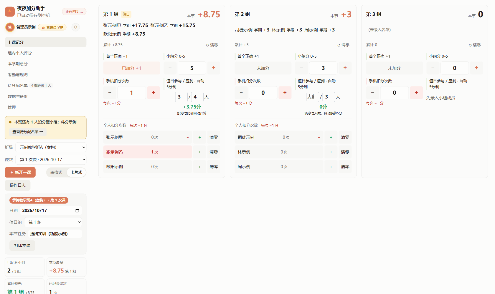

# 夜夜小组制加分助手

本地打印新版：组内个人评分的“打印评分表”在二级弹窗选择当前组/全部组、每组一页/每页两组（默认A4竖向双联，中间裁切线），未命名项目表头留白。首页“打印本课”按每张正面最多6组，紧跟一页加分与换算规则说明；选择双面长边翻转。打印机双面设置由用户在浏览器/驱动中选择，网页不直接控制。数据只读，纸上手写后需回网页补录。当前尚未发布。

界面原则：主界面只留关键分数和高频操作；状态、说明、规则与设置优先放二级弹窗/页面。最新本地考勤版首页只显示成员序号和考勤分，点击后登记状态及本次扣分。教师可以自定扣分，并调整迟到早退折算次数、旷课挂科门槛及开关；默认3次折1次、合计3次挂科。折算只用于标记，不追加扣分；挂科姓名标红，更正记录或规则后自动重算。

专用于小组制课堂的记分助手：宽屏侧栏、完整姓名卡片、纸质风格表格、个人扣分、项目评价、排行、名单分组、A4打印，以及教师账号间隔离的云端记录。

**[打开正式应用](https://ye-ye-score-api.zcq991029.chatgpt.site/) · [完整图文使用指南](docs/使用指南.md) · [问题反馈](https://github.com/zcq19991029/ye-ye-group-score-helper/issues)**

无需安装，使用浏览器访问。新教师凭管理员邀请码注册并导入自己的名单；GitHub仅保存源码，不使用GitHub Pages作为应用入口。



## 功能与图文入口

所有公开截图均用临时数据库、虚构账号与学生采集；不含正式班级名单、真实分数、有效邀请码、重置码或密码。

| 功能 | 主要用法 | 配图 |
| --- | --- | --- |
| 教师登录 / 邀请注册 | 已有账号登录；新教师凭一次性邀请码开通 | [登录](docs/screenshots/01-login.png) / [注册](docs/screenshots/02-register.png) |
| 班级名单导入 | 下载CSV模板，Excel另存UTF-8 CSV导入 | [导入与备份](docs/screenshots/10-import-backup-sync.png) |
| 名单与分组 | 搜索、手动分组、均匀分配待分配学生、添加成员 | [分组](docs/screenshots/09-roster-groups.png) |
| 课次管理 | 新开课次，填写日期、任务和值日组，查看历史记录 | [新课次](docs/screenshots/06-new-lesson.png) |
| 课堂记分 | 首个正确、小组分、手机扣分次数、值日分；两套布局 | [卡片](docs/screenshots/04-card-scoring.png) / [表格](docs/screenshots/05-table-scoring.png) |
| 个人扣分与撤销 | 完整姓名按钮，点击扣1分，右键/长按返还；最多60步撤销 | [卡片操作](docs/screenshots/04-card-scoring.png) |
| 组内个人评分 | 10个自定义项目，每项0–5分，独立小计、签名和备注 | [项目评价](docs/screenshots/07-individual-assessment.png) |
| 排行统计 | 小组累计、个人总分及逐课次明细，零分不画彩条 | [排行](docs/screenshots/08-rankings.png) |
| 打印与导出 | 打印本课/排行/本组评价，导出CSV，JSON完整备份与恢复 | [输出入口](docs/screenshots/10-import-backup-sync.png) |
| 云端同步 | 同账号换设备恢复；明确冲突覆盖方向 | [同步入口](docs/screenshots/10-import-backup-sync.png) |
| 个人资料与密码 | 改显示名/备注、修改密码、一次性重置码找回 | [资料](docs/screenshots/12-profile.png) / [改密](docs/screenshots/13-change-password.png) / [找回](docs/screenshots/03-forgot-password.png) |
| 管理员 | 发放邀请码、查看教师记录、核验身份后发重置码 | [管理](docs/screenshots/11-administration.png) |
| 手机与操作反馈 | 单列卡片、44px点击区域、实际变化反馈、减少动态模式 | [手机](docs/screenshots/14-mobile-card.png) |

## 快速上课

本地待发布的课堂精简版：默认250px侧栏，宽屏表格铺满剩余空间。课堂表仅显示本节成绩，个人/全组学期累计请到本学期总分页查看。首个正确使用对勾，点亮加1，再点取消。值日单元格仅显示分数，点击选参与人数，确认后按应到人数自动换算；应到默认小组人数，弹窗可展开调整。历史分数不反推人数，取消不改分，撤销/重做同时恢复分数与人数。

1. 注册/登录 → “数据与备份”下载模板并导入CSV。
2. “待分配名单”确认分组 → “上课记分”选择班级、新开一课。
3. 课堂点击加减或直接输入数字，留意“每次−1分”的扣分次数。
4. 课后查看排行，按需打印/导出，确认顶部“已同步到云端”。

课堂小组合计 = 首个正确 + 小组分 + 值日分 − 手机未入袋次数。个人总分 = 小组累计 + 个人项目累计分 − 本人个人扣分。项目分自动计入个人总分和赋分。管理员有教师数据查看权限，普通教师彼此隔离。

更详细的操作步骤、CSV字段示例、分数算例、跨班撤销、密码找回、打印说明与常见问题见[完整图文使用指南](docs/使用指南.md)。

## 正式版架构

单个 Cloudflare Worker 托管网页和接口，D1 保存教师账号、邀请码、名单、课次和记分记录。通过 Sites 发布，GitHub 只保存源码和自动检查，不再使用 GitHub Pages。不依赖 WorkBuddy、微信登录或旧站历史数据。

现有站点已发布；实际验收状态以项目交接.md 为准。`.openai/hosting.json` 保存唯一站点 ID，不要重复创建服务。真实名单不进入公共静态种子。

## 教师使用

1. 管理员首次使用服务端设置的一次性启动码注册，自行设置账号和密码。
2. 管理员在“管理”页生成一次性教师或管理员邀请码。
3. 教师凭邀请码注册，之后使用自己的账号和密码登录；各账号数据独立。
4. 在“数据与备份”下载 CSV 模板，将 Excel 名单另存为 UTF-8 CSV 后导入。必填列为班级、姓名、学号；小组和班内序号可选，小组留空为待分配。每组最多 6 人。
5. 新开课次并记分。记录先写入当前浏览器，再同步 D1；换设备登录同一账号可恢复云端记录。
6. “组内个人评分”对应组长课堂评分表：按班级、课次、小组录入最多10个自定义项目，每名成员每项0–5分。评分按完整学号保存（未有学号时用稳定成员ID），可随账号同步并打印或下载Excel；评分自动计入个人累计与赋分，不改变课堂小组分或违纪扣分记录。该表不重复显示合计列，本节总计查看上课记分主表的“本节合计”。打印表最后一列右边框加深，签字栏只显示“组长”并留出手写空间。

新教师首次登录仅提供一个空的“我的班级”模板，真实班级名称和名单登录后自行导入。初始化不会复制其他教师的班级名称、名单或课次；已有账号继续使用自己的云端记录。已有课次的班级不能直接替换名单，以免个人扣分对应错位；新学期使用新的班级名称。姓名相同但学号不同的学生分别识别。

本节小组分 = 首个正确 + 小组分 + 值日分 − 手机未入袋人数；个人总分 = 小组累计 + 个人项目累计分 − 个人扣分。个人扣分不扣小组分。两套记分布局和打印规则继续保留。

## 同步与备份

云端以账号和版本号确定归属及更新顺序。两台设备发生不同修改时会提示冲突，保留当前浏览器的修改；请先下载 JSON 备份，再明确选择从云端覆盖本机或把本机覆盖云端。不要将“当前浏览器已保存”误认为“云端已同步”。

退出登录不删除工作副本，但切换账号会隔离并归档上一账号的本机记录。浏览器数据被清除后，未成功同步的改动只能通过备份恢复。旧 WorkBuddy 本机存档不会自动上传到新账号，用户已决定重新导入名单。

## 开发与发布

界面参考本机 open-claude-ui 的 AGENTS.md、cds-theme.css、CdsButton.tsx、SegmentedControl.tsx 与 ClaudeMotionPresets.ts：采用暖灰表面、陶土强调、轻边框、分段控件和 CSS 缓动，继续使用原生网页，无需引入 React。Excel 计分色与打印样式独立保留。名单导航角标统计全部班级，页内指标统计当前班级并明确标注。

ui-feedback.js仅负责记分高亮、实际增减浮字、撤销定位与布局切换反馈，不保存业务数据。布局微动效160–180ms，记分使用约1秒静态高亮和约0.9秒反馈，不缩放数字；减少动态效果时保留静态反馈。弹窗和操作说明继续使用原生dialog/details的键盘与焦点行为。

前端源文件为 index.html、styles.css、app.js、cloud.js、config.js、roster-import.js、leader-scoring.js、password-ui.js、ui-feedback.js。config.js 的 apiBase 留空即使用同站接口，不放入任何凭据。

后端源文件为 backend/worker.mjs，首次 D1 迁移为 backend/migrations/0001_initial.sql。密码在服务端加盐派生，服务器只保存会话令牌摘要；所有数据接口校验账号，管理接口校验角色。站点公开的是登录页和程序资源，名单与分数只能通过受保护接口访问。

首次需要在 tools/test-runtime 目录执行 npm ci 安装开发测试依赖。于项目根目录运行：

```text
rtk proxy <Node路径> tools/test_backend.mjs
rtk proxy <Node路径> tools/test_passwords.mjs
rtk proxy <Node路径> tools/test_online.mjs
rtk proxy <Node路径> tools/build_site.mjs
rtk proxy <Node路径> tools/test_site.mjs
```

前三类验收分别覆盖真实 SQLite 语句、前后端联动、打包后的同站程序。测试全部使用虚构账号和学生，不操作生产数据库。dist/server/index.js 是含公开网页资源的单个 Worker 模块，dist/.openai 带站点配置和 D1 迁移；发布包不含真实 data.js。构建版本记录在同站 version.json 中。

新服务需要在服务端机密配置中设置 BOOTSTRAP_CODE，首次管理员注册后不可复用。默认同站访问无需 ALLOWED_ORIGINS；只有明确增加外部前端时才配置该项。机密不得进入 config.js、仓库或截图。

推送或部署前先检查完整文件清单并暂存，运行 `rtk proxy <Python路径> tools/check_no_pii.py`，检查 Git 索引的禁止路径和真实姓名、完整学号。二进制截图还需确认采集来源和实际画面；本仓库公开截图使用隔离的虚构数据。原GitHub Pages入口已关闭。

## 本机私有材料

data.js、教学材料、迁移记录和项目归档只在本机保留，不进仓库或发布包。旧WorkBuddy/Pages说明、旧截图、一次性迁移脚本、重复发布包和历史备份已移入项目归档中的本地ZIP，附逐文件SHA256清单；需要历史材料时按原相对路径恢复。迁移记录仅留账号开通说明、最近正式备份和仍需使用的交接提示词。当前使用指南与虚构配图位于docs/。

现行源码、教学材料、名单生成工具及有效回归测试保留。旧截图生成器依赖已废弃的WorkBuddy SDK和不存在的预览页，已从tools移出，不再作为开发入口。旧本地预览服务已停止，生产入口为上方正式站。原299项WorkBuddy测试仅作为历史归档，现行检查以tools/test_*.mjs及GitHub工作流为准。

界面配色按原始 Excel 的蓝色成员区、浅杏记分区、粉色手机扣分区、绿色值日区、浅黄合计区呈现，固定浅色主题。教师资料保存成功会显示绿色勾选动效；管理员皇冠由服务器角色决定。

## 密码管理

密码支持 6–128 位。登录后从个人信息进入修改密码，验证原密码后修改，所有设备须重新登录；未同步记录先同步。忘记密码从登录页进入，教师先联系管理员核验身份，管理员在管理页填写教师账号，生成30分钟有效的一次性重置码。新码使旧码失效，重置成功会退出所有设备，名单和成绩保留。

若唯一管理员忘记密码，由站点所有者通过 Sites secret 临时配置 PASSWORD_RECOVERY_CODE 并部署，管理员在忘记密码页使用维护者提供的一次性恢复码；不使用启动码代替恢复码。恢复码使用后不可重复使用，维护者应移除该机密配置。

### 最新计分规则
个人总分 = 全组累计加分 + 个人项目累计分 − 个人扣分。全组小组分为0–5，组内个人评分的各项目自动计入每人的个人总分（旧文中的独立不汇总说明已作废）。旧制超过5分记录保留。操作日志显示具体对象和变化；撤销即时执行，可重做恢复。

## 当前正式规则：学习91＋考勤9

- 每节课自动增加一个5分小组项目；任一组新增命名个人项目，全班同步，每项满分5。
- 学期值日是全班统一的一个5分项目，从有课次起计入每人分母；未完成按0，完成后按5×参与人数/应到人数计分。同组多次记录取最高分，最多5；13节课也只增加这一次5分，不是65分。支持课次设置选择多个值日组。
- 项目净得分＝个人项目累计＋各课小组项目累计＋学期值日有效分−全组扣分−本人扣分。扣分允许负余额，后续得分先抵扣。小组扣分作用于组内每一位成员，组内评分合计包含本课小组净分和本人扣分。
- 完成率＝clamp(项目净得分/项目满分,0,1)，学习分＝91×完成率。原始负余额不截断，只将用于赋分的比例限制在0%–100%。删除首个正确栏目；历史首答只在对应课小组5分项目内兼容计入，不额外增加满分或突破5分。
- 考勤分＝max(0,9−累计考勤扣分)。默认迟到早退各扣1、旷课扣3、请假不扣。迟到早退合计3次折旷课1次，不重复扣分。开启标记时，考勤归零或实际加折算旷课达到门槛标红挂科。扣分值、折算门槛、挂科门槛和开关可由教师修改，历史记录保留扣分快照。
- 平时分＝学习分＋考勤分；计入总评＝平时分×40%，包含学习最多36.4分、考勤最多3.6分。完成率75%全勤：平时77.3、计入总评30.9；100%全勤：100、40。期末需考＝max(0,(及格线−平时分×0.4)/0.6)，向上取0.1；考勤挂科显示不适用。
- 输入完成离开输入框后自动保存并重算；考勤确认保存后重算。网页、排名、打印、Excel共用同一派生成绩。打印记分格和合计为0时留白，负分保留；数据库0分保留，项目名居中。
- Excel成绩为下载时快照，线下修改不会自动回写网页。实际考试空白表示待考，0是有效成绩。

### 项目列与省纸打印
组内个人评分默认4列，可新增或删除（1–30列），同课全组同步；空白列不计项目满分。删除有名称或已评分的列须确认，删除后全班完成率重算。历史有名称或有分数的列保留。打印可选每页1、2、3、4、6组，A4竖向；少项目可选6组，组多时自动分页，末页不补空白组。0分只在纸上留白，数据库保留；负分照常打印。

### 自定义打印分页
组内评分表打印支持逐页输入组数，如13组填7,6或5,4,4；每页1–8组，合计须匹配所选组数。留空则按每页上限自动均分，避免末页仅一组。打印使用独立文档并仅在相邻页面之间分页，预留打印高度余量。

组内评分导出已替换为下载打印版Excel：复用打印范围与逐页分配，同一份打印HTML转为可编辑表格，每纸一张工作表，A4竖向单页，保留配色、表头、成员/学号、项目、合计、签名与备注，0分留白。13组7/6生成两张工作表，openpyxl核查样式/合并/单页设置通过；单站58及交互114回归通过。Excel/WPS实体打印驱动的像素一致性未实测。

新课次小组项目默认5/5：创建时为所有组保存5分，每名成员计入项目净得分。个人扣分只影响本人，全组手机扣分影响本组每人，扣分降低完成率并重算右侧三列。历史课次不批量重写，明确清零仍为0；值日及个人项目不赠分，未完成仍计入分母。

最新扣分口径（覆盖负分跨课抵扣规则）：手机与个人扣分仅作用于本课每人的小组5分项目，合计有效扣分不超过该项目已得分，最低0；其他个人项目、值日不受影响，不留跨课负债。原始扣分次数保留，实际有效扣分按上限计算。新课小组默认5。

姓名下方现显示本节小组项目剩余分而非扣分次数；新课5分，−扣1、＋恢复1，最低0最高本课项目原分（默认5）。“全组−1”逐个成员批量扣1，之后可以独立恢复任一成员。旧手机记录在首次相关调整时等值转为各人扣分，不改变当时剩余分；批量支持整笔撤销/重做，合计与完成率实时重算。打印与Excel姓名下同步显示剩余分，0仍留白。单站62、交互115回归通过。

隐藏全组小组项目原分列；姓名下展示每个人的“本节参与分”（0–5分）。全组−1对本课组内每人各扣1分，只扣本课这5分，最低为0；扣到0后继续点击不再扣分、不产生记录，也不影响其他课次或个人项目。个人＋只恢复该成员本课参与分。本节合计按成员逐人显示：本节参与分＋本节个人项目累计＋本节有效值日分（已包含扣分，不重复扣）。打印及首页Excel同步；学期右侧三列不变。

首页右侧三列按当前选中课次显示历史快照：只累计该课及之前的项目、考勤、完成率、计入总评和期末目标；选到最新课次时显示最新累计。点击平时分打开的个人明细也遵循同一课次截止范围，本课打印沿用该快照，方便切换课次查看分数变化趋势。

默认5分为每课初始基准，不是一条可撤销加分日志。旧共享基准日志已从可撤销区归档（备份保留），旧剩余分不变但个人恢复上限回到5。课后扣分/恢复照常记日志，清零回默认5分。

撤销改为抵消所选操作的实际增减量，不恢复整份旧快照；同一成员有后续修改也可选择旧操作，后续其他字段保留。恢复也可逐条选择。操作受0–5边界限制，仅恢复实际撤销量，避免边界外增分。5分基准不记加分日志；当前5分模型下相邻相关的等量反向操作从有效进度列表抵消，完整二级流水仍可核对。同一成员旧扣分独立撤销、恢复列表任意选择、抵消清理测试通过：单站67、交互115、计分21、后端29。

侧边栏/上课工具新增“一键恢复5分”，可选当前课次、当前班级全部课次、所有班级全部课次。直接初始化小组原分5、手机0、个人扣分空，不生成逐人加分日志；个人项目/值日/考勤保留。相关有效撤销和旧扣分流水转入baselineRecoveryArchive（最近3次，随JSON备份），默认基准不会再次被这些记录撤低。单站70与交互115通过。

特殊表现记录：侧边栏独立按钮，支持班级、日期、多人、正数参考分与事由，修改/可恢复删除、按学生汇总、Excel明细和汇总；保存于班级specialRecords并经Worker校验及账号云同步。完全不参与原始项目积分、完成率、成绩、排名、期末目标。单站76、交互115通过，覆盖分数隔离和云端往返。


跨设备同步核对：切回窗口、页面重新可见及可见时每30秒检查云端版本；本机干净时自动拉取新版本，保留当前页面和班级选择。正在编辑输入框时暂缓自动替换。两端均有变化时保留本机并显示冲突，不静默覆盖；原有服务端版本校验继续阻止检查后发生的并发覆盖。数据页新增“核对云端最新版”，状态显示云端版本与最近核对时间（悬停查看保存时间）。换设备前等“已同步到云端”，换入设备点击核对并等“已核对最新版”后再录入；离线不能确认最新，冲突需先备份再决定保留哪版。四项项目名已从正式云端只读核对，未重写生产成绩。新增8项隔离同步测试：干净拉取、版本时间、双端冲突、本机保留、核对中编辑保护、时间戳无实质修改、待上传提交、离线状态。


打印分页更新：组内评分打印与Excel均改为选择“打印页数”，逐页输入组别范围。13组可选2页，第1页1-6、第2页7-13；也支持逗号分隔不连续组号。自动预填均分范围，校验每页最多8组、重复、遗漏、无效组号及倒序范围；沿用独立打印文档，打印与Excel共用同一分页结果。旧“每页组数/逐页组数”入口已替换。


课堂快捷分组：上课记分的每组提供“解锁分组”，默认锁定。解锁后空成员格（卡片为姓名区）出现＋，点击展开学号搜索，可用完整学号、后两位或姓名筛选本班待分配学生，点击结果立即加入全局分组并自动云同步。相同尾号会列出全部匹配项，以完整学号区分，不自动猜人；已分组学生不重复加入，移组继续使用名单与分组。每组最多6人。完成分组/退出选人、切换页面/班级/课次都会收起编辑入口。现有个人项目、考勤与课次分数不被重写；新增成员沿用本系统的全局成员模型参与各课次组级分数统计。打印隐藏解锁和选人控件。9项新增回归验证默认锁定、尾号筛选、无匹配提示、完整学号落库、已有课次保留、退出锁定、云端往返、待分配名单联动、离页锁定。


操作记录界面改版：参考课堂气泡日志的信息顺序，显示北京时间、班级课次、变更内容和逐条撤销；保留任意记录的增减量撤销逻辑。顶部提供班级与关键词筛选，恢复最近一项为紧凑按钮，逐条恢复放在已撤销区域，完整流水和说明折叠。移除冗余下一步提示和过时的按顺序撤销说明，未记录时间显示历史记录，不伪造操作时间。


同步冲突提示修复：侧栏状态缩短为“同步冲突 · 点击处理”，支持点击或键盘打开独立对话框，完整说明本机/云端都有变更、上传暂停，并提供下载本机备份和进入同步处理入口。错误条可换行并提高显示层级，避免被侧栏/表格遮挡。不自动选一边覆盖。Chrome零分排查：已分别备份旧Chrome副本与云端v256；旧副本的第1/3/4课每人personal=5（5分基准全部被扣），不是新课默认值变0，云端仍为5且个人项目更完整。用户确认两笔值日为真，第3课第3组5云端已存在，仅补第4课第12组3/3人5分，云端变为v257。第4组0分保留。Chrome拉取待UI确认后核验，不能宣称已恢复。


联网同步优化（覆盖旧离线继续记分说明）：上传防抖250ms；进入/切回页面先核对最新版，核对期间与网络/同步异常/冲突时暂停记分入口，成功后自动开放；不提供离线记分入口。未上传数据保留在本机，恢复网络后自动核对/重试。CAS冲突时用上次成功同步快照做三方分字段合并，不同学生、组、项目单元格、考勤对象可自动合并并重试提交；同一分数两端都改（即使结果相同）、分组变动与成绩变动并发、删项目与评分并发、删除与修改、重复课次/重复分组学生等不自动覆盖，仍需处理冲突。日志及撤销记录使用操作ID合并，防止重复或漏项；输入尚未完成则暂缓应用远端，避免冲掉输入。无可用历史基线的旧设备无法安全自动合并，保留备份与人工选择入口。

操作日志严格参考自有classroom-bubble-score/index.html的auditLogPage和audit-table：主表七列为北京时间、来源、课次、学生、加减分、操作后总分、操作；红色正分、蓝色负分、细分隔线、右侧红色描边撤销按钮，横向不足可滚动。新增操作保存当时累计原始积分与实际增减快照，多人整笔操作明确标注全组/每人并按成员顺序显示总分，撤销按钮作用于整笔操作；旧记录无快照则为—，不伪造历史。已撤销可恢复和完整核对流水保留二级展开。


### 完整流水与课次筛选补齐（2026-10-19）

完整流水统一为与课堂气泡一致的七列表格；历史原文保留在学生/详情和悬浮提示中，缺失的历史分值、总分显示—。核对流水不伪造可撤销按钮。新增课次筛选，与班级、关键词同时限制可撤销、已撤销及完整流水；切换班级重置课次。


### 项目一键全员满分（2026-10-19）

组内个人评分新增“一键全员满分”，确认后对当前小组或本课全部小组的每个已命名项目逐人填5分，空白预留列不动。每项满分固定5分；不调整考勤、值日或个人默认5分。按组记录批量操作，支持日志撤销与恢复；已满分不重复记账。


### 电气8班确认分组与7人成员支持（2026-10-20）

同步状态以“云端核对于 月/日 时:分:秒”展示最近成功核对时间（北京时间），不以“最新版”或版本编号暗示持续实时。后台同步、失败及冲突仍显示当前状态，技术版本号保留在悬浮详情中。

按教师确认保留一个7人组，成员保存、导入与分组上限统一为7人。首页及首页打印按实际班级人数展开成员列，普通班仍至少6列；名单编辑提供第7格。调整分组不新建课次、不修改项目成绩或考勤。真实名单与核对材料仅保留本地迁移记录，不提交公开仓库。


### 分组入口精简（2026-10-20）

上课记分表的成员操作采用居中等宽的“− 分数 ＋”，按钮融入单元格底色；全组扣分和值日分采用透明背景。各列按内容估算并共同分配宽度，整表用满可用区域。各组按内容自然撑高，成绩与考勤行紧凑排列，不用浏览器缩小字体来消除留白；窄屏低于可读宽度时横向滚动。

上课记分页取消锁图标，双击组号进入成员编辑，编辑中点“完成”、再次双击组号或退出选人后恢复只读；键盘聚焦组号按Enter也可切换。新增/删除小组在“数据与备份→班级与成员名单”进行。删除前应保留完整备份，空组只清理对应无成员的记分结构。同步成功状态显示最近核对北京时间，不宣称持续最新版。


### 成员序号去重（2026-10-20）

首页及首页打印现改为每名学生一行直接对应，姓名旁保留短号，删除旧成员序号对应方式。


### 每名学生一行（2026-10-20）

首页、首页打印/PDF及可编辑Excel采用10列纵向成员表：组号、成员、本节参与分（0–5分）、考勤分、全组扣分、值日分、本节合计、平时分（完成率）、计入总评、期末需考。每名学生一行直接对应，不再使用成员序号映射；姓名旁保留短号，悬停查看完整学号。同组组号、全组扣分和值日纵向合并。空组显示未分配成员，不预留空成员格。双击组号编辑成员（最多7人），完成后只读；清零本组移入该编辑区。窄屏横向滚动，宽屏填满，不强制缩小字体。计算、存储索引及个人项目评分表保持原有规则。


### 内容自动列宽（2026-10-20）
首页10列根据表头文字、班级最长姓名与短号、分数及按钮最低空间估算内容宽度，中英文按字形宽度加权，再归一为比例。所有列共同分配屏幕空间，不再仅拉宽最后三列；切换班级、成员变化重新生成，窗口变化由百分比自动适应。低于1100像素使用横向滚动，不缩小字号。打印使用同一比例，Excel由相同内容宽度生成可编辑列宽。


### 表格单元格垂直居中（2026-10-20）
移除首页成绩/考勤类旧顶部对齐，统一所有业务表格th/td为vertical-align:middle，覆盖上课记分、个人项目、排名、考勤、名单、日志及打印；保留长文本原水平对齐。首页单行和两行表头统一居中，成绩与完成率容器居中，项目名称输入居中。124项隔离回归通过；Chrome计算样式10个表头均middle，所有数据格无偏离；52人打印仍2页且正面52人完整。未改真实数据及日志。


### 个人成绩明细与同步视觉稳定（2026-10-20）
点击首页某位学生的平时分（或键盘Enter）打开个人学期明细：显示当前逐课5分项目扣分/剩余分、命名个人项目各项得分、值日有效增量、考勤扣分及本节净得分，顶部展示学期完成率和成绩换算。弹窗可从右下角调整大小，受视口最大宽高约束，内部可滚动；这是当前记录说明，不伪造历史操作流水。打印/PDF及对应Excel的全组扣分格统一留空供手写，网页保留全组−1操作。
30秒云端核对触发inert编辑保护时，旧opacity .68造成整表视觉变淡；去掉透明度变化，核对提示改为固定浮层，避免插入文档挤动表格。保留同步校验、编辑门禁及冲突保护。
验收：128项隔离站点检查通过，新增个人明细只显示所选学生、按课次展示、关闭无改分、打印扣分格留空检查。未修改正式成绩、考勤、日志。
