# 夜夜小组制加分助手 · 功能与使用指南

[打开正式站](https://ye-ye-score-api.zcq991029.chatgpt.site/) · [返回项目首页](../README.md)

本指南截图均来自独立的临时数据库，姓名、班级、学号、成绩和账号都是虚构示例。它们用于展示真实程序的界面，不会成为正式账号的初始数据。

## 一、第一次使用：注册与登录

1. 打开正式站，已有账号直接输入教师账号和密码登录。
2. 新教师点击“使用邀请码注册”，填写账号、显示名、两次密码和管理员提供的一次性邀请码。
3. 账号为3–32位字母、数字、点、下划线或短横线；密码为6–128位。
4. 注册后先导入自己的班级名单。新教师只得到一个空的“我的班级”，不会自动出现其他教师的名单、班级或成绩。

普通教师访问自己的数据；管理员另有邀请码、教师资料查看和密码重置权限。请不要把管理员邀请当作普通教师邀请发放。

首次管理员由站点维护者提供一次性启动码开通；启动码和有效邀请码不在本仓库公开。

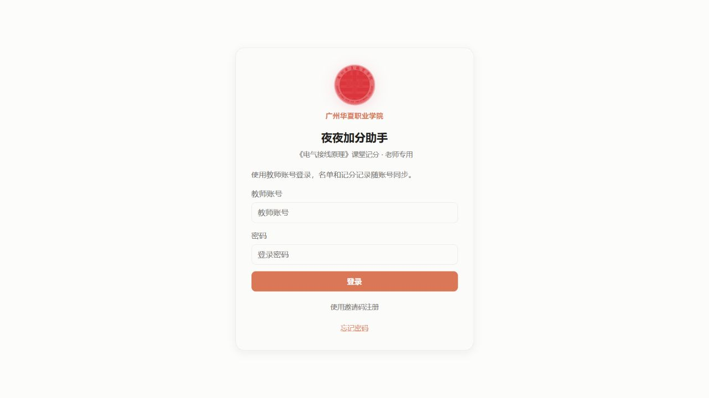

<details>
<summary>查看邀请码注册界面</summary>


</details>

## 二、导入班级名单

在“数据与备份”点击“下载名单 CSV 模板”，用 Excel 填写后另存为 **CSV UTF-8**，再点击“导入名单 CSV”。不直接上传原始 XLS/XLSX。

| 列名 | 是否必填 | 填写方式 |
| --- | --- | --- |
| 班级 | 必填 | 同一班使用相同名称；导入可创建新班级 |
| 姓名 | 必填 | 完整姓名；同名学生按完整学号区分 |
| 学号 | 必填 | 保留完整数字，避免科学计数法和丢失前导零 |
| 小组 | 可选 | 组号；留空进入待分配名单，每组最多6人 |
| 班内序号 | 可选 | 考勤表中的短序号，不代替完整学号 |

```csv
班级,姓名,学号,小组,班内序号
示例教学班,张示例甲,99000000001,1,1
示例教学班,张示例乙,99000000002,1,2
示例教学班,待分示例,99000000003,,3
```

导入前建议下载一份完整 JSON 备份。同名班级的导入是名单替换，已有课次的班级不能直接替换，以免历史个人扣分错位；新学期可使用新的班级名称。重复学号、缺少必填列等错误会被拒绝，应先修正文件再导入。

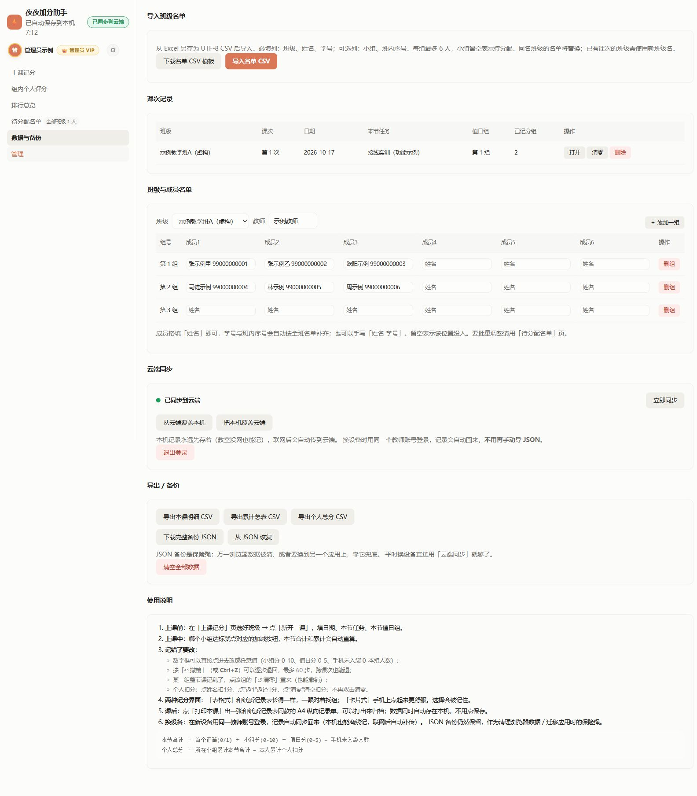

## 三、确定分组与维护名单

进入“待分配名单”选择班级。页面指标统计当前班级；顶部“全部班级 N 人”是所有班级待分配人数的合计。

- 用“仅待分配 / 全部 / 仅已分配”筛选，用姓名、学号或班内序号搜索。
- 在学生右侧选择目标小组，分配后该学生就会出现在记分页对应小组中。
- “均匀分配待分配学生”按班内序号向现有小组轮流补入，保留已分配人员，每组不超过6人。确认前先核对班级。
- “添加学生”填写姓名、班内序号和完整学号；新增学生先进入待分配区。
- 已分配学生可移回待分配。删除学生、调整已有成绩班级的成员时，先备份并核对历史记录。

“数据与备份”的“班级与成员名单”还可维护教师、添加小组、编辑成员；同名学生应填写完整学号，避免仅凭姓名匹配。

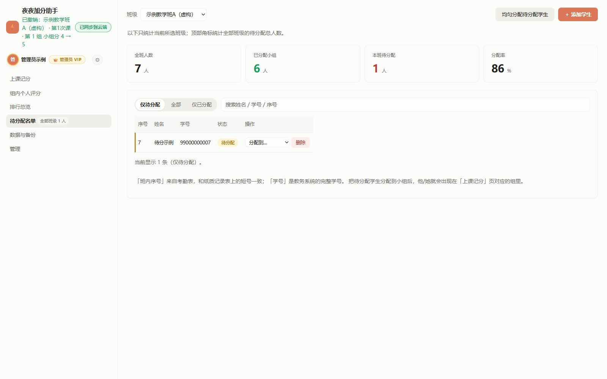

宽屏使用左侧操作栏、右侧分组记分区；窄屏自动恢复顶部操作区。同一组控件只移动位置，不重复创建。

## 四、新开一课与切换历史课次

在“上课记分”先选择班级，再点击“＋ 新开一课”，核对课次、日期、本节任务和值日组后“开始记录”。没有课次的班级会显示“暂无课次”，须先开课才能记分。

之后可通过课次下拉框打开历史课次；日期、任务、值日组可在课次信息栏修改。请确认正在记录哪一班、哪一课，避免把新课堂写进旧课次。

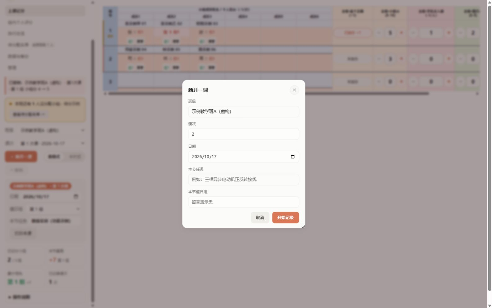

## 五、课堂记分：四类控件

卡片式适合逐组操作和触屏；表格式接近纸质记录表，便于全班比较。切换不会改分数或重排小组。宽屏三列、窄窗两列、手机单列，完整姓名不拆字，同一行卡片控件对齐。

| 项目 | 操作 | 对小组本节分的影响 |
| --- | --- | --- |
| 小组分 | 加减按钮或直接输入0–10 | 加上输入分数 |
| 手机未入袋次数 | “＋”增加扣分次数，“−”减少次数 | 每增加1次扣1分，最多本组人数 |
| 值日分 | 填参与人数，应到默认本组人数、可调整 | 自动按5×参与÷应到换算，保留两位小数 |

**本节小组合计＝小组项目＋本次有效值日分−全组扣分；组内个人合计再含个人项目和本人扣分。**

截图中的第一组：1 + 5 + 2 − 1 = 7分。手机区的“＋”增加的是扣分次数，因此实际分数浮字是“−1”。达到上下限没有数值变化时，不生成成功反馈或新的撤销记录。


<details>
<summary>查看表格式及手机卡片</summary>

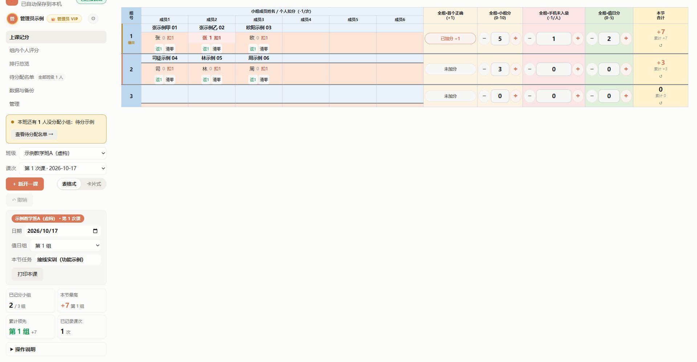

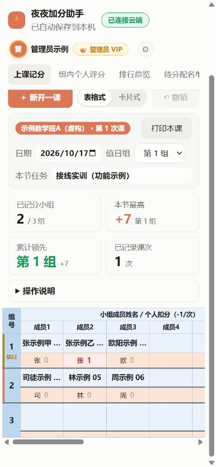

</details>

## 六、个人违纪扣分、撤销与清零

卡片底部每个按钮显示完整姓名和扣分次数，“张示例甲”和“张示例乙”分别记录。

| 操作 | 效果 |
| --- | --- |
| 点姓名一次 | 增加1次个人扣分，即本人−1分 |
| 返1按钮（也支持右键姓名 / 手机长按） | 减少1次扣分，即返还本人1分；最低0次 |
| 清零按钮 | 该成员本课个人扣分归零；双击姓名不再清零 |
| “↶ 撤销”或 Ctrl+Z | 按记录顺序撤销，最多保留60步，可跨课次 |
| 卡片“↺ 清零” | 确认后清空该组本课记分和个人扣分，可撤销 |

个人扣分不扣小组分。**个人总分 = 所在小组累计合计 − 本人累计个人扣分。** 上图第一组7分，张示例乙扣1次，个人总分为6分，其他未扣分成员为7分。

撤销按钮提示会注明班级、课次、小组/成员和恢复值；如果最近操作属于另一班，按钮显示“撤销其他班操作”。撤销会恢复原操作所属课次，不代表撤销当前正在看的班级。恢复的字段会短暂高亮。

“清空全部数据”和删除课次属于更大范围操作，不能等同于卡片清零；使用前先备份。

## 七、组内个人评分：独立的项目评价表

进入“组内个人评分”，依次选择班级、课次、小组。

1. 在表头填写最多10个项目名称，例如“规范操作”“协作交流”。
2. 每位成员每项填写0–5整数或留空。留空表示未评分，0是已给零分。
3. 小计自动计算；可填写组长/复核人和备注，填写后自动保存并同步。
4. 点击“导出本组CSV”或“打印本组评分表”。无课次时先回到“上课记分”开课。

项目评价按本人、课次独立保存，自动汇入个人原始累计及任务达成率。个人总分＝全组累计净加分＋个人项目累计分−个人扣分；项目小计与原始总分、百分制赋分分别展示。

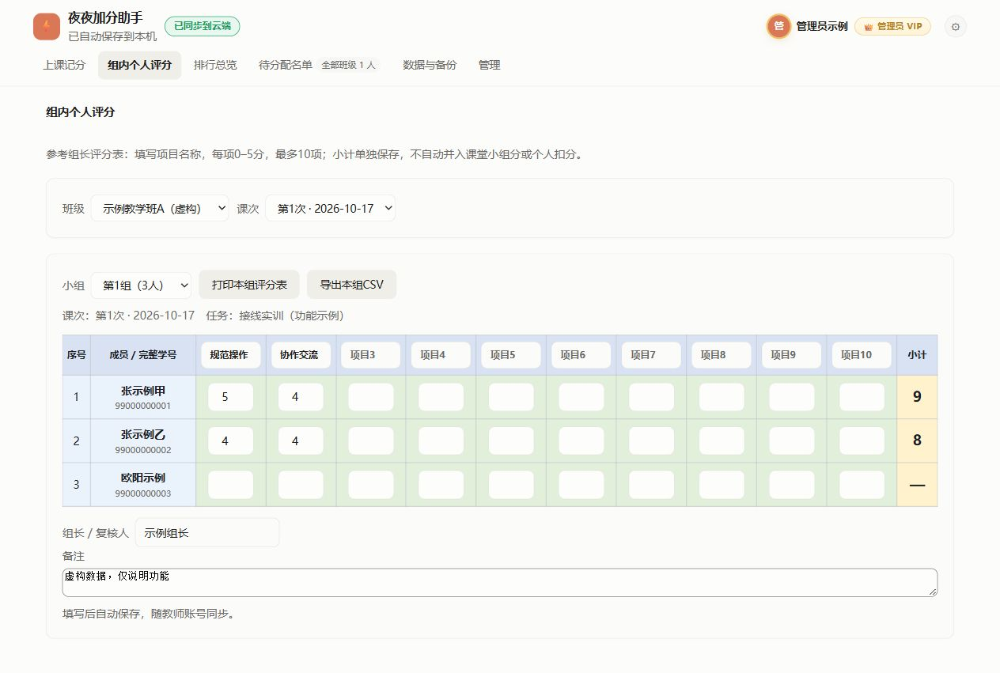

## 八、排行与历史明细

“排行总览”选择班级后，可以查看小组累计排行、个人总分排行和逐课次得分明细。

- 小组排行按累计分比较，零分不绘制彩色条；条长为组间相对值。
- 个人排行按“小组累计−个人扣分”排序；待分配学生需先入组才有对应小组成绩。
- 记分页本节最高与累计领先会注明并列；所有组累计均为0时显示“暂无领先”。
- 卡片的操作顺序保持组号顺序，不会因为刚加分而自动重排。

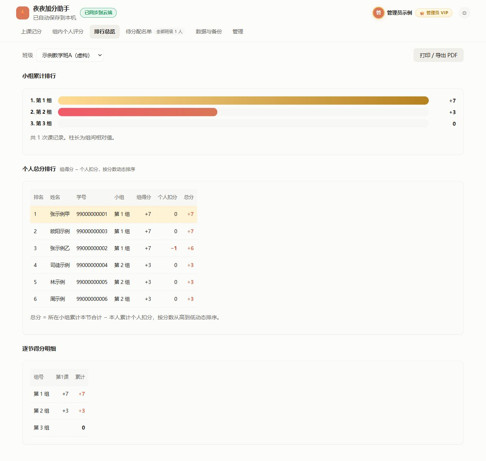

## 九、打印、CSV与完整备份

| 入口 | 输出 | 适用场景 |
| --- | --- | --- |
| 上课记分 → 打印本课 | A4横向课堂记分表 | 纸质归档或在浏览器打印中另存PDF |
| 排行总览 → 打印/导出PDF | 本班排行及明细 | 阶段汇报、打印展示 |
| 组内个人评分 → 打印本组评分表 | 单组项目评价表 | 组长复核与签名 |
| 数据与备份 → 本课明细CSV | 当前课次记分明细 | Excel二次整理 |
| 数据与备份 → 累计总表CSV | 小组累计汇总 | 阶段统计 |
| 数据与备份 → 个人总分CSV | 含个人扣分的总分 | 个人成绩核对 |
| 组内个人评分 → 本组CSV | 项目评分及小计 | 独立项目评价整理 |
| 下载完整备份JSON | 班级、名单、课次等完整工作记录 | 灾备、迁移或恢复 |

打印前先确认班级/课次，在浏览器中选择合适的纸张、横向和缩放；需要原配色时启用背景图形。CSV用于表格分析，不能代替完整JSON备份。JSON恢复会替换当前工作记录，先保存现有备份再执行。

导出、同步、恢复按钮见[数据与备份截图](screenshots/10-import-backup-sync.png)。自动检查覆盖打印内容生成；不同浏览器、纸张及真机触控仍需实际核对。

## 十、云端同步与换设备

1. 记分立即保存到当前浏览器，再上传云端。关注顶部“已同步到云端”，不要只看“已保存到本机”。
2. 网络恢复后会重试未完成上传；“数据与备份 → 立即同步”可主动同步。
3. 换设备时用**同一教师账号**登录，云端名单和课次会恢复，无须每次手动导入JSON。
4. 两台设备同时修改发生冲突时，先下载各自JSON备份，再决定保留哪一份。

| 冲突操作 | 明确的覆盖方向 |
| --- | --- |
| 从云端覆盖本机 | 放弃当前浏览器这份改动，使用服务器记录 |
| 把本机覆盖云端 | 用当前浏览器记录覆盖服务器，影响其他设备后续恢复 |

不要在未备份、不确定方向时连续点两种覆盖操作。清理浏览器会删除未同步的本机记录；退出或切换账号也不等于把尚未上传的内容变成云端备份。

## 十一、编辑个人资料与修改密码

点击右上角头像，修改姓名/昵称及工号/备注后保存。显示名和头像会更新，保存成功有绿色勾选提示；管理员皇冠取决于服务器角色，改名不会授予管理权限。

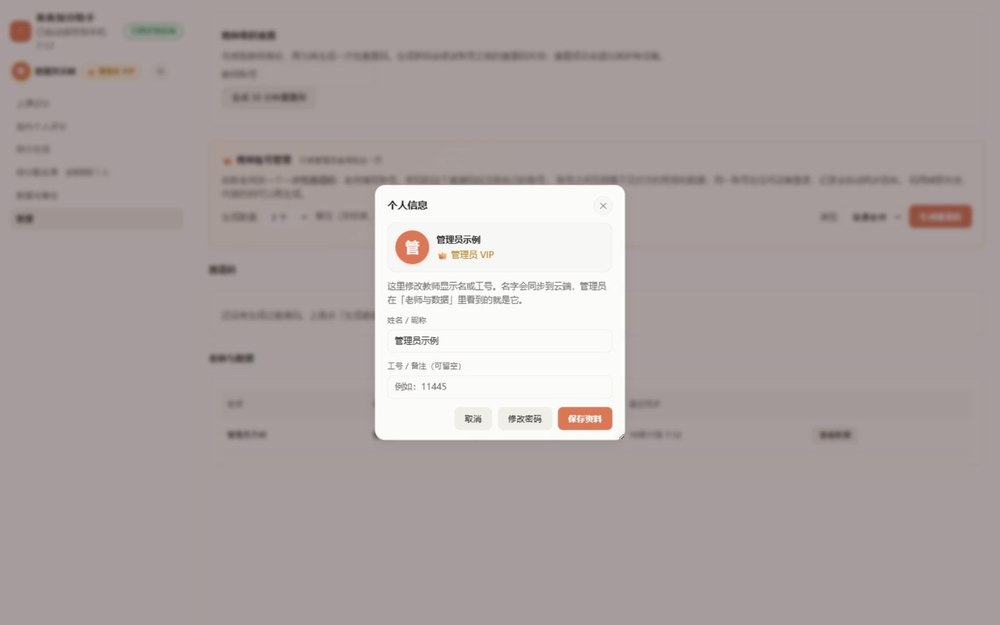

点击“修改密码”，输入原密码和两次新密码。新密码6–128位；修改成功后所有设备会退出，须用新密码重新登录。请自行输入密码，不把密码发到聊天或公开Issue。

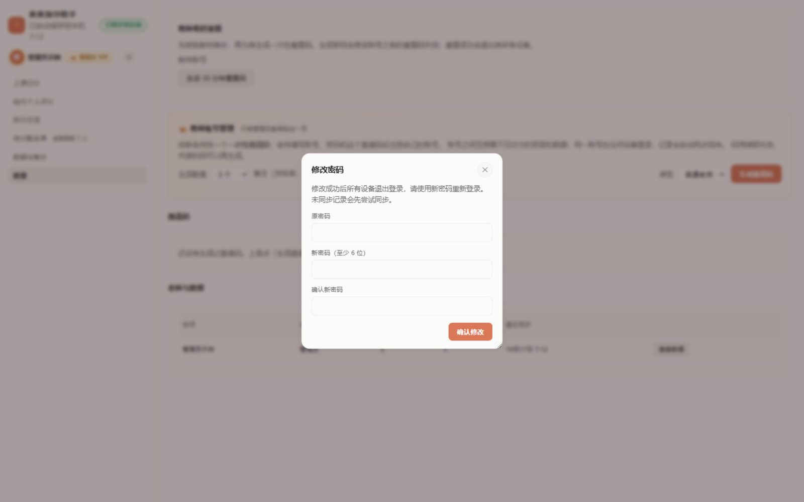

忘记密码：先联系管理员核验身份，领取30分钟有效的一次性重置码，再在登录页“忘记密码”填写账号、重置码和两次新密码。生成新码会使旧码失效；重置成功后所有设备退出，名单和成绩保留。唯一管理员遗忘密码由站点维护者处理，不使用启动码代替重置码。

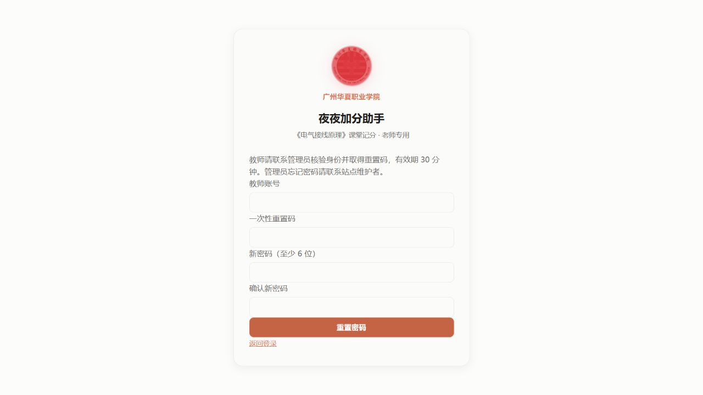

## 十二、管理员：教师、邀请码与重置码

普通教师不显示“管理”页。管理员可：

1. 选择邀请码数量、备注和角色，点击生成。普通教师邀请码与管理员邀请码要区分，码兑换后不能再次注册。
2. 查看邀请码使用情况、教师列表和最近同步时间；按需查看教师云端数据。
3. 核验教师身份后，按账号生成30分钟密码重置码，再通过合适渠道交给本人。

账号隔离是指普通教师不能互看数据，**不表示管理员无法查看教师数据**。截图没有生成或公开任何有效邀请码、重置码。

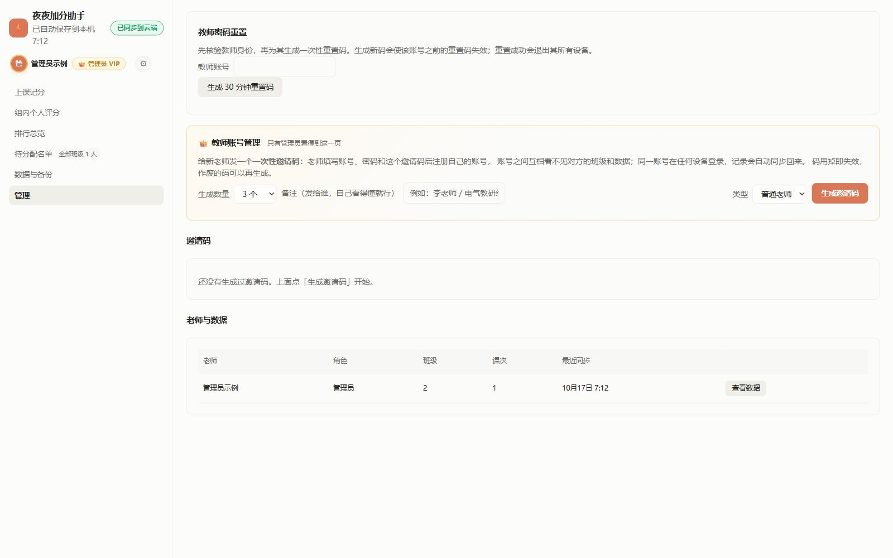

## 十三、操作反馈与无障碍

实际加扣分时，数字高亮约1秒，并在预留位置显示实际增减约0.9秒；表格布局在侧栏保留最近操作文字，不让浮字遮住成员；撤销定位恢复对象。布局胶囊、内容、说明和弹窗使用短过渡，动画不拦截记分点击。系统启用“减少动态效果”后，保留静态高亮和文字提示，停止缩放与移动。

弹窗使用原生键盘焦点与Esc关闭；敏感提交仍需按钮确认。桌面三列、窄窗两列、手机单列已用虚构长姓名和同姓成员检查，触屏手势仍应在实际设备上核对。

## 常见问题

**顶部待分配数为什么比当前班级大？** 顶部合计全部班级，下面指标只统计当前选择的班级。

**手机区点“＋”怎么减分？** 它增加扣分次数，每次−1分；减少次数会返还相应分数。

**组内个人评分会进入排行吗？** 会。保存项目分后自动更新个人原始累计、任务达成率、学习赋分、平时分和期末需考，无需另填总分。

**为什么某班不能导入替换名单？** 该班已有课次。先备份，用新学期的新班级名导入，保留旧成绩。

**为什么无课次班级仍可撤销？** 撤销历史是整个工作记录的最近操作；按钮和完整提示会注明它属于哪一班、哪一课。

**GitHub页面为什么没有我的名单？** GitHub保存源码和虚构截图，真实名单在登录后的账号记录中；正式应用入口不是GitHub Pages。

## 计分更新（2026-10-17，覆盖上文旧公式）
个人项目评价现在自动进入个人总分；个人总分=全组累计加分+个人项目累计分−个人扣分。全组小组分上限5，每名组员都获得全组分；个人项目分只属于本人，不叠加到全组排行。记分表姓名下显示本节项目、全组和个人合计。撤销前可看具体班级/课次/对象/数值，并确认；误撤销可点击重做，继续新记分后重做分支清空。旧制10分历史不自动截断。

## 当前正式规则：学习91＋考勤9

- 每节课自动增加一个5分小组项目；任一组新增命名个人项目，全班同步，每项满分5。
- 学期值日是全班统一的一个5分项目，从有课次起计入每人分母；未完成按0，完成后按5×参与人数/应到人数计分。同组多次记录取最高分，最多5；13节课也只增加这一次5分，不是65分。支持课次设置选择多个值日组。
- 项目净得分＝个人项目累计＋各课小组项目累计＋学期值日有效分−全组扣分−本人扣分。扣分允许负余额，后续得分先抵扣。小组扣分作用于组内每一位成员，组内评分合计包含本课小组净分和本人扣分。
- 完成率＝clamp(项目净得分/项目满分,0,1)，学习分＝91×完成率。原始负余额不截断，只将用于赋分的比例限制在0%–100%。删除首个正确栏目；历史首答只在对应课小组5分项目内兼容计入，不额外增加满分或突破5分。
- 考勤分＝max(0,9−累计考勤扣分)。默认迟到早退各扣1、旷课扣3、请假不扣。迟到早退合计3次折旷课1次，不重复扣分。开启标记时，考勤归零或实际加折算旷课达到门槛标红挂科。扣分值、折算门槛、挂科门槛和开关可由教师修改，历史记录保留扣分快照。
- 平时分＝学习分＋考勤分；计入总评＝平时分×40%，包含学习最多36.4分、考勤最多3.6分。完成率75%全勤：平时77.3、计入总评30.9；100%全勤：100、40。期末需考＝max(0,(及格线−平时分×0.4)/0.6)，向上取0.1；考勤挂科显示不适用。
- 输入完成离开输入框后自动保存并重算；考勤确认保存后重算。网页、排名、打印、Excel共用同一派生成绩。打印记分格和合计为0时留白，负分保留；数据库0分保留，项目名居中。
- Excel成绩为下载时快照，线下修改不会自动回写网页。实际考试空白表示待考，0是有效成绩。

### 项目列与省纸打印
组内个人评分默认4列，可新增或删除（1–30列），同课全组同步；空白列不计项目满分。删除有名称或已评分的列须确认，删除后全班完成率重算。历史有名称或有分数的列保留。打印可选每页1、2、3、4、6组，A4竖向；少项目可选6组，组多时自动分页，末页不补空白组。0分只在纸上留白，数据库保留；负分照常打印。

### 自定义打印分页
组内评分表打印支持逐页输入组数，如13组填7,6或5,4,4；每页1–8组，合计须匹配所选组数。留空则按每页上限自动均分，避免末页仅一组。打印使用独立文档并仅在相邻页面之间分页，预留打印高度余量。

组内评分导出已替换为下载打印版Excel：复用打印范围与逐页分配，同一份打印HTML转为可编辑表格，每纸一张工作表，A4竖向单页，保留配色、表头、成员/学号、项目、合计、签名与备注，0分留白。13组7/6生成两张工作表，openpyxl核查样式/合并/单页设置通过；单站58及交互114回归通过。Excel/WPS实体打印驱动的像素一致性未实测。

新课次小组项目默认5/5：创建时为所有组保存5分，每名成员计入项目净得分。个人扣分只影响本人，全组手机扣分影响本组每人，扣分降低完成率并重算右侧三列。历史课次不批量重写，明确清零仍为0；值日及个人项目不赠分，未完成仍计入分母。

最新扣分口径（覆盖负分跨课抵扣规则）：手机与个人扣分仅作用于本课每人的小组5分项目，合计有效扣分不超过该项目已得分，最低0；其他个人项目、值日不受影响，不留跨课负债。原始扣分次数保留，实际有效扣分按上限计算。新课小组默认5。

姓名下方现显示本节小组项目剩余分而非扣分次数；新课5分，−扣1、＋恢复1，最低0最高本课项目原分（默认5）。“全组−1”逐个成员批量扣1，之后可以独立恢复任一成员。旧手机记录在首次相关调整时等值转为各人扣分，不改变当时剩余分；批量支持整笔撤销/重做，合计与完成率实时重算。打印与Excel姓名下同步显示剩余分，0仍留白。单站62、交互115回归通过。

隐藏全组小组项目原分列；姓名下展示每个人剩余项目分。本节合计按成员序号逐人显示：本节小组剩余分＋本节个人项目累计＋本节有效值日分（已包含扣分，不重复扣）。打印及首页Excel同步；学期右侧三列不变。

默认5分为每课初始基准，不是一条可撤销加分日志。旧共享基准日志已从可撤销区归档（备份保留），旧剩余分不变但个人恢复上限回到5。课后扣分/恢复照常记日志，清零回默认5分。

撤销改为抵消所选操作的实际增减量，不恢复整份旧快照；同一成员有后续修改也可选择旧操作，后续其他字段保留。恢复也可逐条选择。操作受0–5边界限制，仅恢复实际撤销量，避免边界外增分。5分基准不记加分日志；当前5分模型下相邻相关的等量反向操作从有效进度列表抵消，完整二级流水仍可核对。同一成员旧扣分独立撤销、恢复列表任意选择、抵消清理测试通过：单站67、交互115、计分21、后端29。
